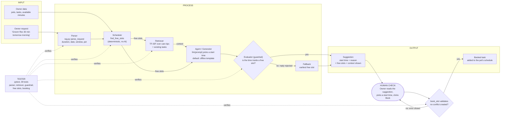
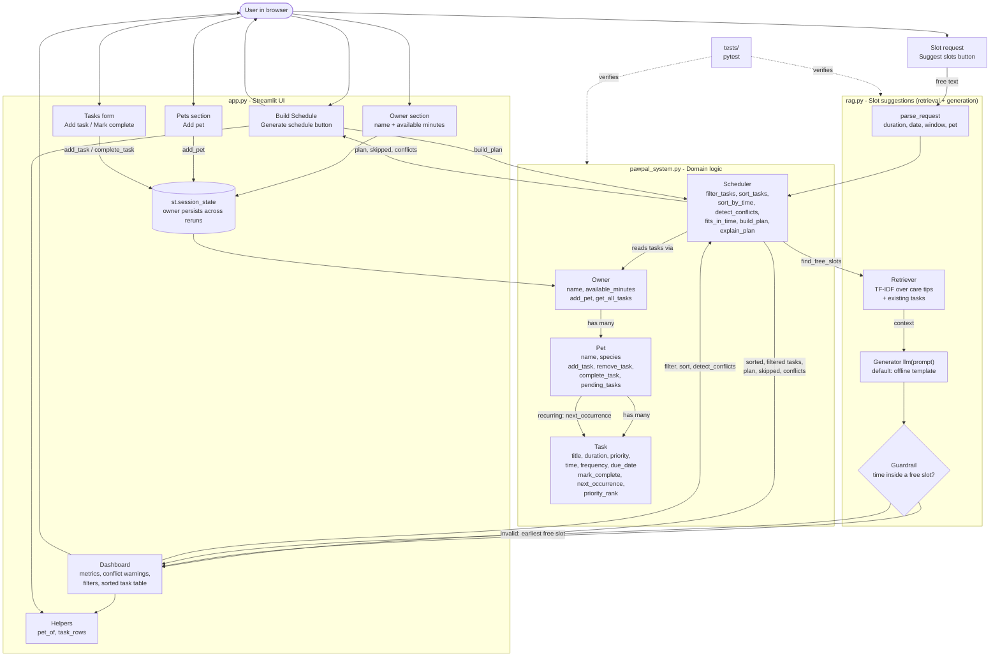

# PawPal+ (Module 2 Project)

You are building **PawPal+**, a Streamlit app that helps a pet owner plan care tasks for their pet.

## Scenario

A busy pet owner needs help staying consistent with pet care. They want an assistant that can:

- Track pet care tasks (walks, feeding, meds, enrichment, grooming, etc.)
- Consider constraints (time available, priority, owner preferences)
- Produce a daily plan and explain why it chose that plan

Your job is to design the system first (UML), then implement the logic in Python, then connect it to the Streamlit UI.

## What you will build

Your final app should:

- Let a user enter basic owner + pet info
- Let a user add/edit tasks (duration + priority at minimum)
- Generate a daily schedule/plan based on constraints and priorities
- Display the plan clearly (and ideally explain the reasoning)
- Include tests for the most important scheduling behaviors

## Getting started

### Setup

```bash
python -m venv .venv
source .venv/bin/activate  # Windows: .venv\Scripts\activate
pip install -r requirements.txt
```

### Suggested workflow

1. Read the scenario carefully and identify requirements and edge cases.
2. Draft a UML diagram (classes, attributes, methods, relationships).
3. Convert UML into Python class stubs (no logic yet).
4. Implement scheduling logic in small increments.
5. Add tests to verify key behaviors.
6. Connect your logic to the Streamlit UI in `app.py`.
7. Refine UML so it matches what you actually built.

## 🖥️ Sample Output

Running `python3 main.py` generates a daily plan and flags scheduling conflicts:

```
Plan for 2026-11-08 (55/120 min used):
- Feed breakfast at 08:00 (10 min, high priority)
- Morning walk at 08:00 (30 min, high priority)
- Brush fur at 09:30 (15 min, low priority)
Warning: 2 tasks at 08:00: 'Morning walk' (Rex), 'Feed breakfast' (Mia)

Conflict check:
Warning: 2 tasks at 08:00: 'Morning walk' (Rex), 'Feed breakfast' (Mia)
```

The Streamlit app (`streamlit run app.py`) shows the same plan and conflict warnings in the browser.

## 🧪 Testing PawPal+

```bash
# Run the full test suite:
pytest

# Run with coverage:
pytest --cov
```

Sample test output:

```
============================= test session starts ==============================
collected 39 items

tests/test_pawpal.py::test_mark_complete_changes_status PASSED           [  4%]
tests/test_pawpal.py::test_add_task_increases_pet_task_count PASSED      [  8%]
tests/test_pawpal.py::test_sort_by_time_orders_numerically_and_puts_untimed_last PASSED [ 13%]
tests/test_pawpal.py::test_sort_by_time_is_stable_for_ties_and_does_not_mutate_input PASSED [ 17%]
tests/test_pawpal.py::test_sort_tasks_priority_beats_time_then_duration_breaks_ties PASSED [ 21%]
tests/test_pawpal.py::test_sorting_empty_list_returns_empty_list PASSED  [ 26%]
tests/test_pawpal.py::test_daily_task_completion_creates_next_day_task PASSED [ 30%]
tests/test_pawpal.py::test_weekly_task_completion_creates_task_seven_days_later PASSED [ 34%]
tests/test_pawpal.py::test_once_task_does_not_recur PASSED               [ 39%]
tests/test_pawpal.py::test_unknown_frequency_does_not_recur PASSED       [ 43%]
tests/test_pawpal.py::test_recurrence_without_due_date_counts_from_today PASSED [ 47%]
tests/test_pawpal.py::test_recurrence_crosses_month_and_year_boundaries PASSED [ 52%]
tests/test_pawpal.py::test_next_occurrence_is_held_back_until_its_due_date PASSED [ 56%]
tests/test_pawpal.py::test_overdue_tasks_are_included_and_completed_tasks_are_not PASSED [ 60%]
tests/test_pawpal.py::test_detect_conflicts_flags_same_time_across_pets PASSED [ 65%]
tests/test_pawpal.py::test_detect_conflicts_ignores_untimed_completed_and_future_tasks PASSED [ 69%]
tests/test_pawpal.py::test_detect_conflicts_misses_overlap_without_identical_start_times PASSED [ 73%]
tests/test_pawpal.py::test_detect_conflicts_with_no_tasks_returns_empty_list PASSED [ 78%]
tests/test_pawpal.py::test_task_that_exactly_fills_budget_fits_but_one_minute_over_is_skipped PASSED [ 82%]
tests/test_pawpal.py::test_greedy_plan_skips_big_task_but_still_schedules_later_small_ones PASSED [ 86%]
tests/test_pawpal.py::test_zero_available_minutes_skips_everything PASSED [ 91%]
tests/test_pawpal.py::test_scheduler_with_no_pets_or_tasks_builds_empty_plan_and_explains PASSED [ 95%]
tests/test_pawpal.py::test_filter_tasks_by_pet_name_is_case_insensitive_and_by_completion PASSED [100%]

============================== 39 passed in 0.03s ==============================
```

## 📐 Smarter Scheduling

> Fill in once you've implemented scheduling logic.

| Feature | Method(s) | Notes |
|---------|-----------|-------|
| Task sorting |Complete taks that are priority | Start time and mins left |

| Filtering | Completion status|  skip tasks if time runs out |

| Conflict handling | Skip if theres still time to leave at the end| overlapping time slots |
| Recurring tasks |Skip until the end  |  daily vs. weekly |

## 📸 Demo Walkthrough

Describe your app in numbered steps so a reader can follow along without watching a video:

1. Start the app 
2. Enter the owner name and the minutes available for pet care today.
3. Enter a name for the pet, choose a species (dog, cat, other) and click add pet
4.   Pick the pet, then enter a title, duration, and priority (low, medium, high).a
5. Check if theres confllict. If two tasks share a start time, a ⚠️ warning appears. Otherwise you see "No scheduling conflicts."
6. Check the task list. Observe if its  pending and completed.
7. Select a task and click if completed. Recurring tasks are rescheduled automatically.
8. Click generate schedule to get an ordered plan that fits your available time. Any tasks that don't fit or that conflict are flagged with warnings.

**Screenshot or video** *(optional)*: <!-- Insert a screenshot or link to a demo video here -->


#Summary 
The completion of tasks being marked completed or still pending. Owner also connects to adding pets into the list.
Also allowing for a time limit for a task to be completed and if its daily or weekly.

### Title and Summary: What your project does and why it matters.
The project was PawPal+ and the updated feature that was implemented was the suggestion of open time slots and considers the amount of time it would take.This matters as it allows for the AI to go through the daily activites and consider the times that would allow to perform the tasks.

### Architecture Overview: A short explanation of your system diagram.

#### How data flows: input, process, output



| Component | Role in this system | Where |
|-----------|---------------------|-------|
| Parser | Turns the free-text request into duration, date, time window and pet | `rag.py` `parse_request` |
| Scheduler | Computes the real free slots with plain code, so the AI never guesses what is free | `pawpal_system.py` `find_free_slots` |
| Retriever | Finds related care tips and the pet's existing tasks as context | `rag.py` `Retriever` |
| Agent / Generator | Picks a start time and explains it (offline template by default, a real LLM can be plugged in) | `rag.py` `suggest_slot` |
| Evaluator | Guardrail that rejects any time outside a free slot and falls back to the earliest one | `rag.py` `suggest_slot` |
| Tester | 39 automated tests check each step above | `tests/test_pawpal.py` |
| Human | Reads the suggestion, chooses the final start time and clicks Book. Nothing is booked automatically | `app.py` |

**Where checking happens:**
1. **Automatic, every run:** the evaluator rejects invalid AI answers, and `book_slot` refuses a booking that would conflict.
2. **Human, every booking:** the owner reviews the suggestion and the shown free slots before confirming.
3. **Developer, before release:** `pytest` verifies the parser, retriever, evaluator and booking logic.

#### Full architecture




The Streamlit UI (`app.py`) keeps the owner in session state and calls the domain logic in `pawpal_system.py` (Owner, Pet, Task, Scheduler) to build plans and detect conflicts. For slot suggestions, `rag.py` parses a free-text request, asks the Scheduler for free slots, retrieves related care tips and existing tasks, and lets a generator pick a start time. A guardrail rejects any time that is not inside a free slot and falls back to the earliest one. `pytest` tests cover both the domain logic and the suggestion code.


### Setup Instructions: Step-by-step directions to run your code.

1) Run the code
2) Enter the info for add pet
3) Write down what tasks needs to be generated
4) AI would give you time slots


#### Sample Interactions: Include at least 2-3 examples of inputs and the resulting AI outputs to demonstrate the system is functional.
Input is Mochi has to get groomed for 30 mins and the output was time opening would be at 8:00 am. Another input would be Mochi photoshoot that would be taking 30 mins and the output was suggested time would be at 8:30am.


### Design Decisions: Why you built it this way, and what trade-offs you made.
The reason why I built it the way it works because it allows for the tasks to get considered by AI to schedule the times that it would work out without having an overlap of times. The trade off that was made was having two ways to be added in the calender but can used to find gaps inbetween times and tasks. 

### Testing Summary: What worked, what didn't, and what you learned.
When having the time suggestions there are two places to place a task which can be considered a trade off since it adds the task twice instead of once which overlaps. The way that it can be fixed is by naming the task with time suggestion a different name and just mark complete the task that before that or skip that the one with setting a time. I also learned that the time suggestion can work for any short or low priority tasks that can be given in any opening gaps that need filling. 

### Reflection: 

This project says about me as an AI engineer that there are some things that would work in the project and if it doesn't what can it be used for. In this case the trade-off example it can be considered as one but can also be used in a different way such as filling in the gaps.


